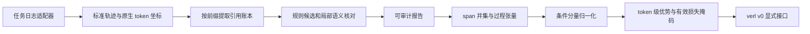

# Ledger-GRPO：长程智能体冗余阶段奖励框架

任务适配器提供约束、动作、观测和原生 token 坐标。框架用前缀账本和局部核对识别冗余，再计算组相对优势。《原始方案修订版》的事件计价已接入 BrowseComp-Plus 原生 HF 训练入口。SAGE 与 SciCode 已使用同一前缀可见性规则完成归档回放，正式计价仍需原生坐标。

原有掩码目标和 verl v0 桥接仍可作为历史对照。事件计价采用留一均值、同伴门控、每轨迹扣分上限和固定损失分母。真实运行的口径见 [事件计价任务卡](docs/EVENT_PRICE_TASK_CARD.md)，阶段证据见 [实跑记录](docs/PILOT_RUN_LOG_20261111.md)。

事件计价的命令行输入是 JSONL。每行包含 `traj_id`、`task_id`、`outcome`、`termination_reason`、`recording_complete`、`response_mask`、`grounding` 和 `events`。事件回执包含 `event_id`、`turn_id`、`known_at`、半开区间 `event_tokens`、`label` 和 `event_cost`。`grounding` 或 `label` 未知时填 `null`。工具返回 token 只进成本，策略 token 的区间必须来自原生日志。

```powershell
python -m ledger_grpo score-events --rows event-rows.jsonl --config event-credit.json --arm targeted --output scores.json
python -m ledger_grpo audit-events --for-pricing --cases reviewed-event-cases.jsonl --output calibration.json
```

`score-events` 支持 `outcome`、`trajectory`、`targeted`、`shuffled` 和 `uniform`。R1 和 R2a 默认价格为零。显式设置正价时，局部及轨迹级计价通过 `--semantic-calibration calibration.json` 使用事件绑定的校准报告。`audit-events` 分别报告人工精确率、B⁺ 标记率、B⁺ 污染率和各分母覆盖率。`--for-pricing` 核对原轨迹摘要、工具事件和四次可比删除结果的绑定，输出也可用于实跑阶段配置的 `semantic_calibration`。两个入口都从冻结清单重算比例。字段见 [事件标签校准](docs/EVENT_LABEL_CALIBRATION.md)。

`scripts/audit_transfer_event_replay.py` 用源清单的 SHA-256 复核两套归档。SAGE
在同轨迹中匹配重复的检索与文档读取。SciCode 在同一子问题、同一草稿修订内
匹配重复的只读操作；成功写入开启新修订，测试调用保留为独立验证动作。
工具参数、返回和更早送达的请求均参与核对。同轮并行调用之间没有先后可见性。

`scripts/prepare_native_sampler.py --dataset sage|scicode --source <冻结采样器> --output <候选脚本>`
生成带原生记录的采样入口，生成前核对原脚本 SHA-256。候选脚本通过
`--native-output` 写入新的运行目录，沿用原输入和采样配置。每轮保存实际 HTTP
请求与响应。训练读取入口 `native_chat_segment` 校验服务返回的 prompt、completion
及逐生成 token 的 logprob。调用 `sampler_tool_adapter.measure_sampler_batch`
把 SAGE/SciCode 的事件记录、该轮原生响应以及下一轮原始请求和响应绑定成
`event_tokens` 与 `event_cost`。传入对应轮次在策略轴上的起始坐标。
只对能核对完整调用和实际送达结果的批次输出事件成本。

完整运行的候选记录可直接生成评分批。输入清单每行包括
`artifact_root`、`source_trajectory_id`、`source_trajectory_sha256`、
`traj_id`、`task_id` 和经独立结果验证的 `outcome`。同题的不同样本使用
各自的原始轨迹目录和不同的 `traj_id`。

```powershell
python -m ledger_grpo prepare-sampler-grpo --dataset sage --manifest verified.jsonl --tokenizer frozen-tokenizer --output prepared
python -m ledger_grpo score-events --rows prepared/EVENT_ROWS.jsonl --config event-credit.json --arm targeted --output scores.json
python -m ledger_grpo score-events --rows prepared/EVENT_ROWS.jsonl --config event-credit.json --arm targeted --native-batch prepared/NATIVE_BATCH.json --output targeted-scores.pt
```

准备入口同时输出 `NATIVE_BATCH.json` 和 `COVERAGE.json`。SAGE 与 SciCode 的
一期重复扣分使用 R2b。语义标签和取证加分须接入经校准的独立判断。
`--native-batch` 核对事件清单摘要、结果分、样本身份和原生 mask，输出由
`hf_pilot_train.py` 读取的 PyTorch 优势张量。续训仍须由实时采样回执绑定已发布
的策略快照，训练器据此核对上一阶段的检查点。

## 运行

过程 Judge 的抽取请求支持 `analyze --compact-evidence`。输入仅保留一份
相同的证据原文，每个观测的 ID、来源、版本和轮次仍完整记录。训练候选可用
`compact_judge_evidence` 选择这套编码，默认使用全文编码。引用核验继续查
原始观测。新编码的语义一致性需在同一批标注上比较。

现有 Python 可直接使用，无需安装本包。账本、规则、评测、judge 客户端只用标准库；优势计算及数值测试需要 PyTorch。本次环境已有 PyTorch CPU。

```powershell
Set-Location -LiteralPath 'C:\Users\24413\Desktop\后训练\ledger-grpo'
$env:PYTHONPATH = 'src;scripts'
$env:PYTHONIOENCODING = 'utf-8'
python -m unittest discover -s tests -v
python -m ledger_grpo demo --output-dir outputs/my-smoke
```

demo 输出六条明确标为合成的轨迹，覆盖检索重复、有效新信息、取证充分度、产物版本不一致、正确/错误轨迹。目录包含 `trajectories.jsonl`、`deltas.json`、`reports.jsonl`、`scores.json`、`runs.jsonl`、`summary.json` 和配置文件。输出使用新目录，已有文件不静默覆盖。

复现逐层调用：

```powershell
python -m ledger_grpo analyze --trajectories outputs/my-smoke/trajectories.jsonl --deltas outputs/my-smoke/deltas.json --rules outputs/my-smoke/rules.json --output outputs/replayed.jsonl
python -m ledger_grpo score --trajectories outputs/my-smoke/trajectories.jsonl --reports outputs/replayed.jsonl --config outputs/my-smoke/config.json --enable-artifact-d4 --output outputs/rescored.json
python -m ledger_grpo evaluate --runs outputs/my-smoke/runs.jsonl --output outputs/evaluation.json
```

`score` 不传配置时 `process_enabled=false`，只计算结果优势。demo 显式打开过程分量用于验证公式，**不代表 judge 已达到启用门槛**。`--enable-artifact-d4` 与判定端 `rules.enable_artifact_d4=true` 都必须显式开启，且轨迹必须声明产物验收约束。

## 原始目标与共用模块



| 文件 | 职责 |
|---|---|
| `schema.py` | 标准轨迹校验、逐层字段白名单、actor 可见信息边界 |
| `ledger.py` | 增量事实、精确引文校验、来源/版本/缺口、最终取证分数 |
| `rules.py` | R1/R2 候选、R3/D 类诊断、G 决策建议与保护条件 |
| `client.py` | OpenAI 兼容 judge，结构化输出、超时、限长、内存缓存、无隐式重试 |
| `pipeline.py` | 逐 turn 判定、完整报告、span → policy token、离线优势 |
| `advantages.py` | 条件标准化、整组门控、R 衰减、D 有界偏移、对照变换 |
| `batch_payload.py` | 按轨迹 ID 将报告接入真实 rollout batch，严格核对原生掩码 |
| `verl_adapter.py` / `verl_plugin.py` | 显式 v0 dispatch 桥，保留 token 信号，拒绝不支持的接口 |
| `evaluation.py` | 成本/预算、judge 标注评测、按题配对 bootstrap、删除结果分类 |
| `judge_smoke.py` | 终端输入 judge API，运行合成局部判别案例 |
| `credentials.py` / `credential_dialog.py` | Windows 用户加密凭据与支持 Ctrl+V 的密码输入框 |

默认奖励范围是 R1、R2 和轨迹级 grounding；D4 只对显式的产物版本合同可选启用。R3、D1、D2 span、D3 是诊断结果，不自动进入 v1 局部奖励。没有“查满 N 次必须提交”规则；G 只输出继续、转向、审查或提交建议。

R1 必须有已支持的同一事实、没有新信息，并经局部语义核对；仅 replay 账本而没有语义核对器时，R1 弃权。R2 默认只接受同缺口、同方法、规范化后完全相同的查询及无新增返回；近似匹配阈值可配置，但需要标注验证。首次获取、新文档、snippet → fulltext、独立试验与有理由重试受到保护。

## 输入合同

详细可运行示例由 demo 生成；`schema.py` 中各级 `*_FIELDS` 是允许字段的准确清单。

| 字段 | 要求 |
|---|---|
| `traj_id` / `task_id` | 唯一轨迹 ID / 同题采样组 ID；不同任务不能共用 task_id |
| `task` / `constraints` | actor 可见题目与明确约束；不可从金标答案反推 |
| `outcome` | 独立结果验证器给出的整数 0/1；judge 不接收此字段 |
| `complete` | 是否正常完成；截断设置 false；它不等于实际提交 |
| `submitted_candidate` | 最终候选 ID，与最后实际提交一致；可由提交动作明确推断 |
| `response_mask` | response 轴上的原生策略 token 为 1，工具/提示/填充为 0 |
| `turns[].token_start/token_end` | 同一轴上的半开区间；有序、不重叠、覆盖全部策略 token |
| `turns[].action` | kind、target_id、query/method、可选 fact_id/candidate_id 等 |
| `turns[].observations` | 唯一 evidence_id、document_id、source_id、实际 text、version、representation |
| `turns[].artifact` | artifact_id、内容版本、write/test/submit；test 必须有真实布尔 passed |

`source_id` 应标识真实来源链，同源转载不要伪装成独立来源。未知来源留空，不能得到完整 grounding。`document_id` 单独不同不构成独立证据；来源、内容、版本和表示共同决定文档是否新增。版本应来自内容身份，而非 judge 自述。

只接收 actor 看到的观测；特权资料放顶层 `privileged`，不会传入 judge。字段白名单不能识别正文里人为混入的金标文本，因此日志适配器仍须保证输入来源。约束、动作元数据和 token 坐标由可信适配器提供，不能让 actor 自报保护标记来规避奖励。

replay delta 的格式为 `{"traj_id":{"turn_id":{"facts":[...]}}}`。显式空 facts 表示该 turn 已检查但没有事实更新；缺失 delta 表示未知，会触发过程 QA 回退。事实必须带 constraint/candidate ID，supported/refuted 必须引用该时点已可见的原始文本。引用偏移是 Unicode 字符位置，不是 tokenizer token 位置。

报告的 `spans[].turns` 是**明确列举的 turn ID**，如 `[3,7]` 只含这两个 turn，不表示闭区间。v1 规则通常输出单 turn span。冗余掩码对重叠取最大置信度并集，不叠加计数；D4 与 R 重叠时 D4 优先。`confidence=1` 是二元规则权重，不是经过校准的概率。

## 接真实 judge

已有本地服务时：

```powershell
python -m ledger_grpo analyze --trajectories your-traces.jsonl --judge-base-url http://127.0.0.1:8000/v1 --judge-model YOUR_SERVED_MODEL --output outputs/judged.jsonl
```

客户端默认只连接 loopback，不自动启动模型、下载权重或读取凭据。服务须实现 `/chat/completions`、JSON object 输出，且正常完成时返回 `finish_reason=stop`。截断、无效 JSON、连接失败或证据关系不确定均不会被记成“没有增量”。同一模型做抽取与支持复核仍有相关错误，不能据此声称独立验证。

用户需要输入 API 时，运行 `scripts/judge-smoke.ps1` 会在终端询问地址、模型名、密钥；密钥用隐藏输入，默认只留在进程内存，不放进命令行、代码或报告。该工具只发送仓库内合成的微型例子，远程地址由用户显式输入；使用密钥的远程地址要求 HTTPS。结果是接口/局部判别检查，不能替代真实轨迹校准或正确率评估。

DeepSeek 官方接口已有预设，下面的命令**只询问 API key**，地址预填为官方地址，测试模型为 `deepseek-flash`，显式关闭 thinking 并要求 JSON 输出。此型号只用于接口检查，不表示最终本地 judge 已选型。参数依据 [DeepSeek 官方接口文档](https://api-docs.deepseek.com/api/create-chat-completion/) 于 2026-11-11 核对。

```powershell
pwsh -NoProfile -File scripts/judge-smoke.ps1 -Provider deepseek -RememberKey -InputMode dialog
```

`-RememberKey` 按用户明确要求启用：先经官方 `/models` 验证，再用当前 Windows 用户的 DPAPI 加密保存至 `%LOCALAPPDATA%\LedgerGRPO\deepseek-key.dpapi`。后续同一入口自动解密复用，磁盘上没有明文 key。鉴权失败不会保存新输入，并允许在同一个终端内有限次重输。跨 Windows 账号或机器不能直接复用这份密文。

2026-11-11 实测：密码输入框完成认证和加密保存；随后不再输入 key，读取密文并再次认证成功。DeepSeek 的六个合成局部判别案例全部匹配预期，无 API/格式错误。完整结果见 `outputs/deepseek-dialog-20261111/result.json`，本地验证边界见 [VERIFICATION.md](docs/VERIFICATION.md)。

## GRPO 接口

```python
from ledger_grpo.advantages import AdvantageConfig
from ledger_grpo.batch_payload import attach_reports
from ledger_grpo.verl_adapter import apply_to_batch, NoValidTrainingRows

cfg = AdvantageConfig(process_enabled=False)  # 校准完成后显式改变
# data.non_tensor_batch 须有 traj_id 和 uid 或 task_id；mask 来自 rollout。
attach_reports(data, trajectories, reports, config=cfg)
try:
    apply_to_batch(data, cfg)
except NoValidTrainingRows:
    # runner 跳过整个更新并补采样，不能继续 optimizer.step。
    raise
```

必须在**完整同题组、完整 batch**计算，然后才拆 rank/microbatch。纯离线 `score_batch` 返回 `effective_response_mask`；训练 loss/KL 使用该掩码并排除无效行，不能继续使用原始全行分母。

QA 失败或无法定义最终 grounding：高层 v1 将该题组的全部过程分量关闭，保留结果信号。任一轨迹训练无效：该题组排除。全错组：在 D 偏移前排除。全对组：保留效率/取证比较，因此某些正确轨迹可以是负优势。局部 R 只衰减成功轨迹的正优势；D 的 beta=0 不会把已有负优势变正。

分量裁剪后不一定仍为零均值；批级只缩放，不重新居中。标准差退化时缩放系数设为 1，避免放大数值噪声。混合组会核验实际 G 下的符号锚定条件；默认权重和 0.25 对 G=16 不满足严格不等式，会直接报错。

verl 接口固定参考提交、插件载入和分布式验收边界见 [VERL_INTEGRATION.md](docs/VERL_INTEGRATION.md)。普通 import 不会修改 verl。当前仅支持 v0；真实 DataProto、Ray 和 GPU 训练尚未验收。

## 对照与效果评测

`score --control targeted|uniform|shuffle|trajectory` 可对比原定位、同额均匀、token 调整值置换、仅轨迹分量。verl 的 `algorithm.ledger_span.control/seed` 提供对应训练路由。当前 shuffle 保留每条轨迹调整值多重集与总量，**不是保持连续 span 长度的整体搬移对照**；后者仍需进一步实现。

run 输入至少包含 `task_id,outcome,complete,cost`；可选 `sample_id,budget,gen_tokens,tool_calls,ctx_tokens,grounding_score`。cost/budget 须使用同一单位。成本含错误轨迹，未观测字段报告 coverage，不能补成零。均值、P90/P95、超支率、同题成本 CV 可由 evaluate 导出。

```powershell
python -m ledger_grpo compare --baseline baseline.jsonl --candidate candidate.jsonl --resamples 2000 --seed 17 --output outputs/comparison.json
python -m ledger_grpo audit --gold human-labels.jsonl --predictions judge-labels.jsonl --output outputs/judge-audit.json
```

compare 按题聚类、题内先均值，再等权配对 bootstrap；拒绝不一致题集、样本数或 sample_id。audit 输入为预先枚举的 `(task_id,traj_id,turn_id,label,verdict)`，verdict 为 positive/negative/uncertain，须同时包含负例；缺预测按弃权计，正例弃权计入召回损失。该接口是对齐后的分类评测，不是 span 重叠 F1。

“正确率基本不下降”应使用真实保留题集上的基线对比与事先设定的容许差值验证，不能从优势符号推出。尚未实现自动调权训练控制器、异步奖励调度、judge 投票校准、连续 span 搬移和具体数据集的原始日志适配；这些属于下一阶段，不会在本框架里被假装已经跑通。实现修正与假设见 [DESIGN_NOTES.md](docs/DESIGN_NOTES.md)。
