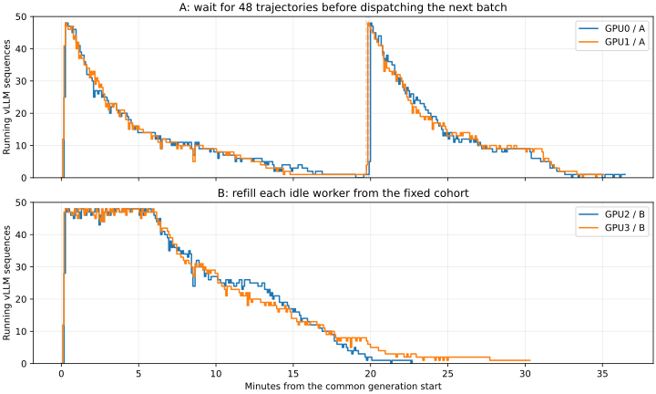

# SciCode 冻结生成配置与调度实测

冻结配置见 [scicode_gen_frozen_20261121.yaml](../../configs/scicode_gen_frozen_20261121.yaml)。实际生成源码提交为 `fac7a8ddb4761e84b50829cb51610ee7ba06ef7c`，运行时 YAML SHA-256 为 `b4dcbd2d273997bffb4f6df8f1fdaa01adc671b432a967b508a16aaa1c78fe44`。

每卡 48 worker，MTP=2，批次 token 上限 16,384。四卡运行同一配置，保留冻结模型、Thinking、采样与生成预算。新入口只从带日期的 YAML 加载推理参数，CPU 预检确认命令行覆盖会被拒绝。

## 历史模拟

| 每卡轨迹 | A 整批等待 | B 任务池 | A/B | B 缩短 | A worker 空等 |
|---:|---:|---:|---:|---:|---:|
| 96 | 1:24:57 | 0:46:38 | 1.82× | 45.1% | 80.6% |
| 192 | 2:49:54 | 1:02:20 | 2.73× | 63.3% | 80.6% |

从 100 条历史 SciCode 轨迹取 Actor 次数，按每次 27.7 秒估计耗时。以固定的 48 个子题，各两次或四次的顺序比较两种调度。模拟把每次调用耗时视为常数，无法反映活跃 worker 变少后单次调用加快的现象。96 条档达到 10% 实跑门槛。

## 四卡完整实跑

同一份 48 个官方子题，每题独立跑两次。四卡都按相同题目、repetition 及 seed 完成全部 96 条。A 等每批 48 条全部结束才开启下一批。B 在单卡共享队列中按固定顺序补派任务。原始子题的两次运行均到终态后才发布整组；正式测试在 CPU 作业中执行。时间从四卡共同开始发送任务计到该卡最后一条完成写盘。

| GPU | 调度 | 完成 | 总墙钟 | 轨迹/小时 | GPU 平均利用率 | Worker 空等 | 抢占 | OOM | 官方通过 |
|---|---|---:|---:|---:|---:|---:|---:|---:|---:|
| GPU0 | A | 96/96 | 0:36:31 | 157.8 | 90.8% | 73.7% | 0 | 0 | 33/96 |
| GPU1 | A | 96/96 | 0:35:08 | 164.0 | 92.6% | 72.7% | 0 | 0 | 34/96 |
| GPU2 | B | 96/96 | 0:22:46 | 253.0 | 93.6% | 45.8% | 0 | 0 | 38/96 |
| GPU3 | B | 96/96 | 0:30:23 | 189.6 | 94.3% | 58.6% | 0 | 0 | 33/96 |

以组内较慢卡完成时间计，A 用时 **0:36:31**，B 用时 **0:30:23**，B 快 **1.20 倍**，墙钟缩短 **16.8%**。每卡平均用时分别为 0:35:49 和 0:26:35。

虚线是 A 的第二批开跑时刻。Worker 空等是分配的 48 个槽位中没有在处理轨迹的时间占比。

## 负载与正确性核对

| 调度 | 轨迹 | Actor 次数 均值/中位/P90/最大 | 输出 token 均值/中位/P90/最大 | 官方正确 | 评分基础设施异常 |
|---|---:|---|---|---:|---:|
| A | 192 | 17.2 / 11 / 42 / 83 | 19,047.1 / 8,846 / 53,252 / 104,580 | 67/192（34.9%） | 0 |
| B | 192 | 16.8 / 10 / 39 / 83 | 18,219.9 / 9,073 / 50,121 / 124,672 | 71/192（37.0%） | 0 |

逐项核对了 192 对原题、repetition 和种子，每组完整覆盖同一清单。B 始终使用固定顺序派发，长短轨迹都计入结果。相比 A，B 的平均 Actor 次数低 2.4%，平均生成 token 少 4.3%，官方正确率高 2.1 个百分点。

A 有 1 条记录以代码测试超时后的输出类型错误结束，B 有 1 条官方测试超时。两条均保留在各组分母内。两组实际生成长度略有差异，这也可能影响实测用时。

## CPU 与验证

- 整机 CPU 平均 9.8%，约五秒统计窗口峰值 26.0%，达到 90% 的时间占比 0.0%。
- 本作业按 24 核折算，平均 38.7%，约五秒统计窗口峰值 124.9%，达到 90% 的时间占比 2.4%。

整段 CPU 未持续饱和。作业短时使用量超过名义 24 核预算，整机 CPU 仍有余量。

Slurm 194964 完成历史模拟和模型哈希。初次 CPU 校验 194966 发现一项抄录的配置文件哈希不完整，未启动 GPU。修正该哈希后，194969 通过。正式生成 194970、官方评分 194983 和 MTP 对照 194984 分开计时。194983 保存完 384 条评分后因绘图库缺失退出。195159 从已保存评分恢复汇总，随后在本机用 Matplotlib 渲染 422 个监测采样点。未重跑生成或评分。训练端旧策略概率的代码位置与 MTP 对照见 [logprob 来源](LOGPROB_SOURCE.md)。
